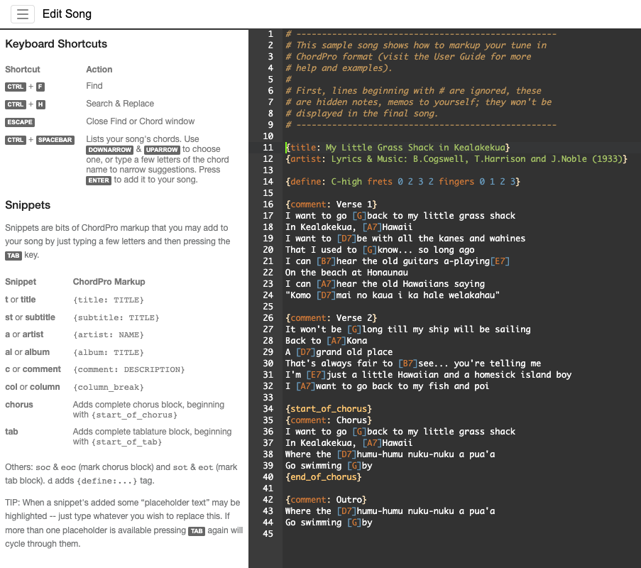

# UkeGeeks Ace Editor ChordPro Language Extension

ChordPro song editing extension for the [Ace Editor](https://ace.c9.io/) (version 1.26.0).

Try it on the [demo page](https://buzcarter.github.io/ace-chordpro-extension/), which loads only the published bundle (`dist/ace-chordpro.min.js`), or the [Live Editor Demo](https://buzcarter.github.io/ace-chordpro-extension/editor.html) (includes Help tips)

For a basic setup look at [Live Minimal Editor](https://buzcarter.github.io/ace-chordpro-extension/basic.html)

**Important:** *This is early stages of updating the UkeGeek's Scriptasaurus Song Editor, as such,
this is an alpha test release: the final installation & usage is likely to change greatly.*



## Part of the UkeGeeks family


- **[ukegeeks.org](https://ukegeeks.org)**: edit a song online, the User's Guide, and the blog.
- **[UkeGeeks Songbook](https://github.com/buzcarter/UkeGeeks)**: your own songbook app, run with Node.js or PHP.
- **[Song Formatter](https://github.com/buzcarter/song-formatter)**: chord diagrams and songsheets on your own website.
- **[ACE ChordPro Extension](https://github.com/buzcarter/ace-chordpro-extension)** (this repo): ChordPro editing for the Ace code editor.

Not sure which one you need? See [which UkeGeeks tool is right for you](https://ukegeeks.org/projects/).

## Installation

Download the files and run locally:

```
git clone https://github.com/buzcarter/ace-chordpro-extension.git
```

Download the [project Zipped from GitHub](https://github.com/buzcarter/ace-chordpro-extension/archive/refs/heads/main.zip)

Use within another app:

```
npm install @ukegeeks/ace-chordpro-extension
```

## Demo

Load "editor.html" (includes help sidebar) in your browser.

Currently the `define` & `tab` statements auto-complete snippet defaults to four strings (for ukulele fans out there)

## Usage

Load "basic.html" (a barebones usage) in your browser.

```html
<pre id="songEditor" class="my-editor">
{title: The Tao of Lasso}

Boy, I [A7]love meeting [D7]people’s moms.
It’s like [B7]reading an [E7]instruction manual 
as to why they’re [G] nuts.
</pre>
<script src="{path to your installation}/dist/ace-chordpro.min.js"></script>
```

```js
const EDITOR_ID = 'my-editor';

// Let Ace know where it should inject itself on the page,
// it will grab the contents within this elemtn (`<pre/>`)
const editor = window.ace.edit(EDITOR_ID);

// choose a color scheme (see Ace prebuilts for dozens of choices)
editor.setTheme('ace/theme/idle_fingers');

// Now we tell Ace to treat our text as ChordPro
editor.session.setMode('ace/mode/chordpro');
editor.setOptions({
    enableBasicAutocompletion: true,
    enableSnippets: true,
});
```

## License

This library is licensed under [GNU General Public License](http://www.gnu.org/licenses/gpl.html).

Use it, change it, fork it, but please leave the author attribution.

## Development

```
npm install
npm run build   # writes dist/ace-chordpro.min.js and dist/styles/
npm test        # tests the built bundle in a simulated browser page
npm run lint
```

## Changes in 1.0.0

* **Chord autocomplete is scoped to ChordPro editors.** The mode now provides its own completer instead of replacing the completers of every Ace editor on the page. In a ChordPro editor, Ctrl+Space lists the song's chords first, followed by Ace's usual snippet and word suggestions.
* Numbers inside `{define}` and tab blocks are highlighted (`constant.numeric`).
* The bundle starts with its licence header, and Ace's BSD notice is kept intact.
* The CSS ships in `dist/styles/`.
* Correct Ace version in the docs: 1.26.0.
* Build is a small Node script (no webpack); tests run in CI.

## Demo site

`.github/workflows/deploy-demo.yml` builds the bundle on every pull request, and on every push to `main` publishes the demo site to GitHub Pages: `index.html` (uses `dist/`), `editor.html` and `basic.html` (use `src/`).

One-time setting: Settings → Pages → Source: **GitHub Actions**.
